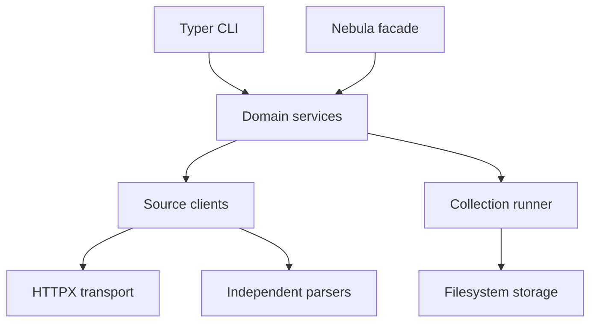

# Architecture overview

Nebula separates HTTP transport, source-specific retrieval, parsing,
domain operations, collection, persistence, and user interfaces.

Direct source clients remain public. The facade constructs clients lazily,
so a Congress.gov key is needed only when that source is used. Shared HTTP
configuration controls timeouts, retries, and concurrency without forcing
HTML, XML, YAML, and JSON sources into one retrieval pattern.
